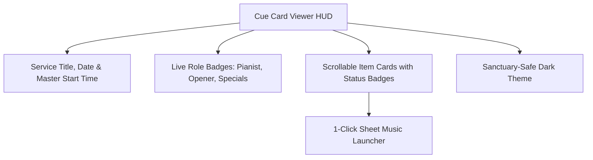

# Interactive Cue Card Viewer

The **Cue Card Viewer** (`central_cuecardviewer.php`) is Cue Central's high-performance live interface for mobile devices, tablets, and stage confidence monitors. It delivers an optimized, low-distraction view of the order of service.

---

## 🚀 Launching the Viewer

1. Open **Cue Cards** (`central_cuecards.php`) from the main menu.
2. Click any published service card.
3. The Viewer loads in responsive standalone layout.
4. For embedded stage displays or OBS browser sources, append `&embedded=1` to strip extraneous margins and navigation bars:
   ```text
   https://cue.corp.lbcgj.com/central_cuecardviewer.php?service_id=42&embedded=1
   ```

---

## 🖥️ Stage & Monitor Capabilities



### 1. High-Legibility Typography
The viewer uses oversized, crisp sans-serif fonts designed to be readable from several feet away on a music stand or podium:
* **Item Number & Sort Badge**: Bold sequencing indicators.
* **Song Title / Main Text**: Heavy 800-weight typography for instant scanning.
* **Supplemental Notes**: High-contrast secondary typography (e.g. *Key of Eb - Modulate to F on verse 3*).

### 2. Embedded Digital Sheet Music Shortcuts
If a service item is linked to a song in the choir library (`choir_song_id`) or hymnal (`hymn_id`), an inline musical note icon appears:
* Tapping the icon opens the arrangement directly in the **In-App Sheet Music Viewer** without losing your place in the service flow.

### 3. Sanctuary Dark Mode
Sanctuary stages and choir lofts often require subtle, low-emission screen lighting to avoid distracting congregations:
* The Cue Card Viewer defaults to a dark navy background (`#0b0f19`) with reduced blue light scatter.
* Contrast ratios comply with WCAG AAA standards for maximum readability in dim auditorium environments.

---

## ⏱️ Security & Expiration Policies

To maintain system integrity and prevent unauthorized viewing of past or unapproved services:

```php
// SECURITY: Verify the requested ID is one of the top 5 published services
$topServices = $db->query("
    SELECT id FROM services 
    WHERE is_published = 1 
    ORDER BY service_date DESC, service_time DESC, id DESC 
    LIMIT 5
")->fetchAll(PDO::FETCH_COLUMN);

if (!in_array($serviceId, $topServices)) {
    die("Cue card not available.");
}
```

> [!NOTE]
> Past services automatically roll off the public viewer 3 hours after scheduled service completion (`service_time + 10800 seconds`), keeping the interface focused solely on active and upcoming worship events.
