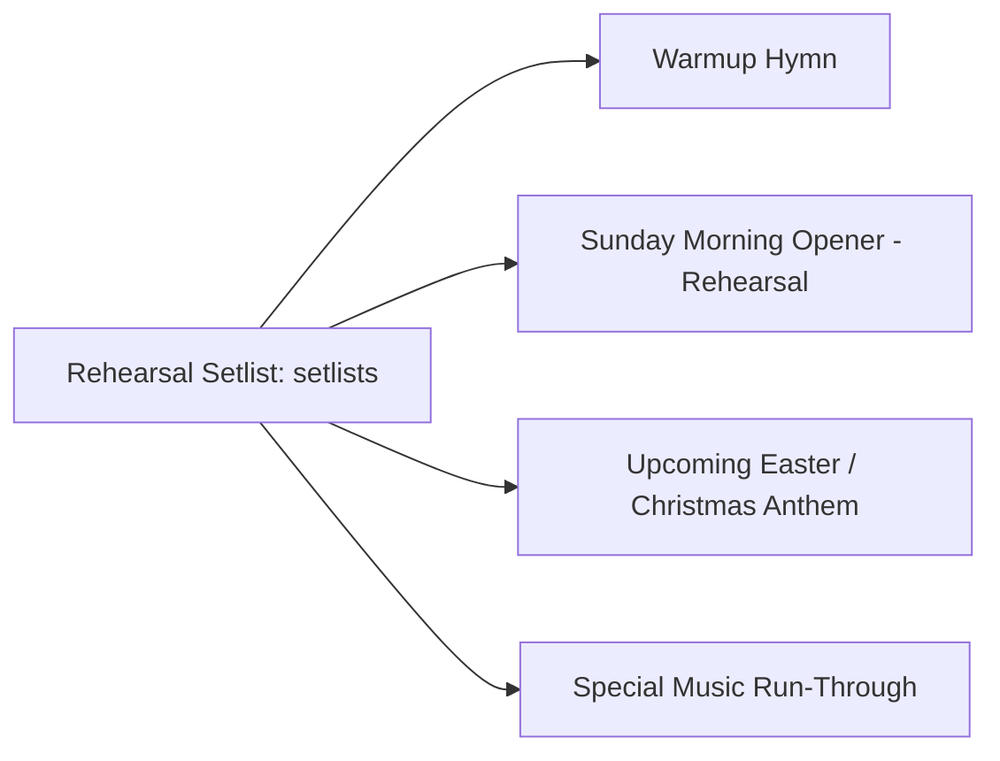

# Rehearsals & Setlists

Cue Central provides dedicated setlist tools to plan mid-week rehearsals, Sunday morning sound checks, and choir practice sessions without disrupting published worship service flows.

---

## 🎼 What is a Setlist?

While a **Cue Card** represents the exact chronological service order for the congregation, a **Setlist** represents an ordered rehearsal sequence for musicians and vocalists.

### Database Tables:
* `setlists`: Stores setlist headers (`id`, `name`, `date`, `notes`).
* `setlist_items`: Ordered list of songs, hymns, and rehearsal notes linked to `setlists.id`.

---

## 📱 Interactive Setlist Viewer

Musicians can launch the **Setlist Viewer** (`setlist_viewer.php`) on tablets and laptops:

1. View the target tempo (BPM), key signature, and estimated rehearsal duration for each piece.
2. Tap any song to open the sheet music PDF in split-screen or full-screen mode.
3. Access attached rehearsal audio tracks to verify phrasing, entrances, and dynamics.
4. Review director rehearsal notes (e.g. *Measure 42: Tenors watch pitch on top F#; cut off on beat 3*).

---

## 🔗 Repertoire Usage History

When assembling setlists or scheduling service openers:
* Cue Central tracks when each anthem or hymn was last sung.
* Prevents unintentional repetition (e.g. singing the same opener within a 6-week window).
* Allows directors to balance high-energy gospel anthems, classic sacred hymn arrangements, and contemporary worship pieces.
