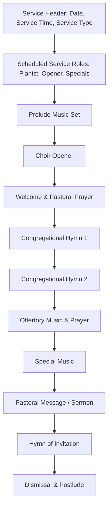

# Understanding Cue Cards

In Cue Central, a **Cue Card** is the real-time, step-by-step master sequence for a specific worship service. It serves as the single source of truth for the pulpit, platform musicians, choir, sound booth, broadcast video team, and lighting operators.

---

## 📋 Anatomical Structure of a Cue Card

A Cue Card organizes every element of the church service chronologically:

### Key Components:

1. **Service Header**:
   * **Service Date**: Formatted as Day of week, Month Day, Year (e.g. *Sunday, November 15, 2026*).
   * **Service Time**: Scheduled start time (e.g. *10:30 AM*, *6:00 PM*).
   * **Service Type**: Classification (*Sunday Morning*, *Sunday Evening*, *Wednesday Midweek*, *Special Service*).

2. **Platform & Ministry Roles**:
   * **Accompanist / Pianist**: Name of the scheduled keyboardist.
   * **Choir Opener Group**: Assigned choir ensemble or section.
   * **Offertory**: Scheduled musician or ensemble.
   * **Special Music**: Vocalist, ensemble, or instrumentalist presenting the feature piece.

3. **Service Items**:
   * **Item Type**: Visual badge categorizing the element (e.g. *Congregational*, *Choir Special*, *Pastoral*).
   * **Main Text**: Primary song title, scripture passage, or announcement topic.
   * **Supplemental Info**: Arrangement details, stanza numbers (e.g. *Stanzas 1, 2, 4*), key signature, or transition instructions.
   * **Sort Order**: Explicit numeric order defining the sequence.

---

## 🎨 Visual Color Hierarchy

Cue Cards utilize high-contrast color badges configured in `type_colors` so operators can distinguish cues at a glance from across the stage or control room:

| Item Type | Accent Color | Intended Ministry Function |
| :--- | :--- | :--- |
| **Choir Opener** | Purple / Violet | Call to worship piece performed by the sanctuary choir. |
| **Congregational** | Indigo / Deep Blue | Hymns sung collectively by the congregation and choir. |
| **Special Music** | Emerald Green | Solos, duets, trios, or ensembles singing the sermon preparation piece. |
| **Prelude** | Amber / Orange | Pre-service instrumental prelude sets. |
| **Pastoral / Prayer** | Slate Gray | Pastoral welcome, pastoral prayer, scripture reading. |
| **Sermon / Message** | Crimson / Rose | Preaching and exposition of the Word. |
| **Invitation** | Cyan / Teal | Altar call and congregational response hymn. |

---

## 🔒 Publishing & Visibility Controls

Cue Cards remain in **Draft** status while directors build and arrange service items in the Cue Builder. 

* **Unpublished Services**: Only visible to administrators and directors within the builder interface.
* **Published Services (`is_published = 1`)**: Instantly rendered on the Cue Central Dashboard and Cue Cards tab for all volunteers, choir members, and musicians.
* **Rolling Availability**: Cue Central automatically surfaces the top 5 upcoming published services to prevent clutter while keeping current rehearsals in immediate reach.
