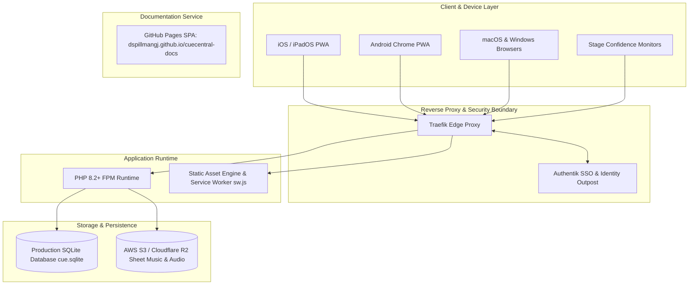

# Architecture & Technology Stack

Cue Central is engineered with an emphasis on lightning-fast response times, operational reliability, and minimal server footprint. It combines modern edge reverse-proxying with lightweight, robust backend services.

---

## 🏛️ System Architecture

---

## 💻 Technology Stack Breakdown

| Tier | Technology | Purpose |
| :--- | :--- | :--- |
| **Edge Routing & SSL** | Traefik v3 | TLS termination, Let's Encrypt certificates, forward-auth headers. |
| **Authentication & IAM** | Authentik | Single Sign-On, MFA, forward authentication outpost, user groups. |
| **Application Runtime** | PHP 8.2+ | Server-side execution, template rendering, and database queries. |
| **Database** | SQLite 3 | Embedded, zero-configuration relational database with WAL mode. |
| **Object Storage** | AWS S3 / Cloudflare R2 | Large digital sheet music PDFs, audio demonstration MP3s. |
| **Frontend Styling** | Tailwind CSS + Custom CSS | Glassmorphism UI, responsive layouts, dark & light themes. |
| **Client PWA** | Service Worker (`sw.js`) | Asset caching, manifest generation, offline stage resilience. |
| **Documentation Hub** | SPA Engine + Marked.js + Prism | Instant Markdown docs rendering, client search, hosted on GitHub Pages. |

---

## ⚡ Performance Optimizations

1. **SQLite WAL Mode**:
   SQLite is operated in **Write-Ahead Logging (WAL)** mode (`PRAGMA journal_mode=WAL;`), enabling concurrent readers without blocking write transactions.
2. **Zero-Build Documentation**:
   The documentation engine requires zero compilation steps during content updates. Markdown files are ingested live via client-side fetch and rendered in milliseconds.
3. **Optimized Service Worker**:
   Core UI icons, typography, and layout files are cached on initial launch, reducing subsequent page load latency to near zero.
