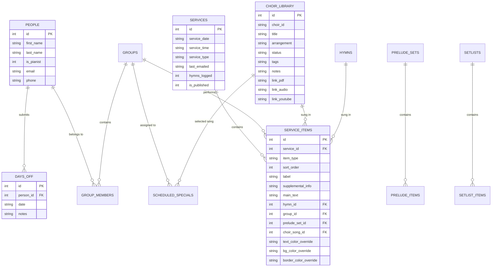

# Database Schema & ER Diagrams

Cue Central operates on an optimized SQLite relational database (`cue.sqlite` in production, `cue_dev.sqlite` in staging).

---

## 🗄️ Entity Relationship Diagram

---

## 📋 Table Definitions

### 1. `people`
Stores volunteer accounts, contact info, and special pianist designations.
* `id` (INTEGER PRIMARY KEY)
* `first_name` (TEXT)
* `last_name` (TEXT)
* `is_pianist` (INTEGER 0/1)
* `email` (TEXT UNIQUE)
* `phone` (TEXT)

### 2. `services`
Stores master worship service instances.
* `id` (INTEGER PRIMARY KEY)
* `service_date` (TEXT, `YYYY-MM-DD`)
* `service_time` (TEXT, `HH:MM`)
* `service_type` (TEXT, e.g. `Sunday Morning`, `Sunday Evening`, `Wednesday`)
* `last_emailed` (TEXT, timestamp)
* `hymns_logged` (INTEGER 0/1)
* `is_published` (INTEGER 0/1)

### 3. `service_items`
Ordered items comprising each service's Cue Card.
* `id` (INTEGER PRIMARY KEY)
* `service_id` (INTEGER, FK -> `services.id`)
* `item_type` (TEXT, e.g. `Choir Special`, `Congregational`)
* `sort_order` (INTEGER)
* `label` (TEXT)
* `supplemental_info` (TEXT)
* `main_text` (TEXT)
* `hymn_id` (INTEGER, FK -> `hymns.id`)
* `group_id` (INTEGER, FK -> `groups.id`)
* `prelude_set_id` (INTEGER, FK -> `prelude_sets.id`)
* `choir_song_id` (INTEGER, FK -> `choir_library.id`)

### 4. `days_off`
Blackout dates submitted by volunteers.
* `person_id` (INTEGER, FK -> `people.id`)
* `date` (TEXT, `YYYY-MM-DD`)
* `notes` (TEXT, `All Day`, `Morning Only`, `Evening Only`)
