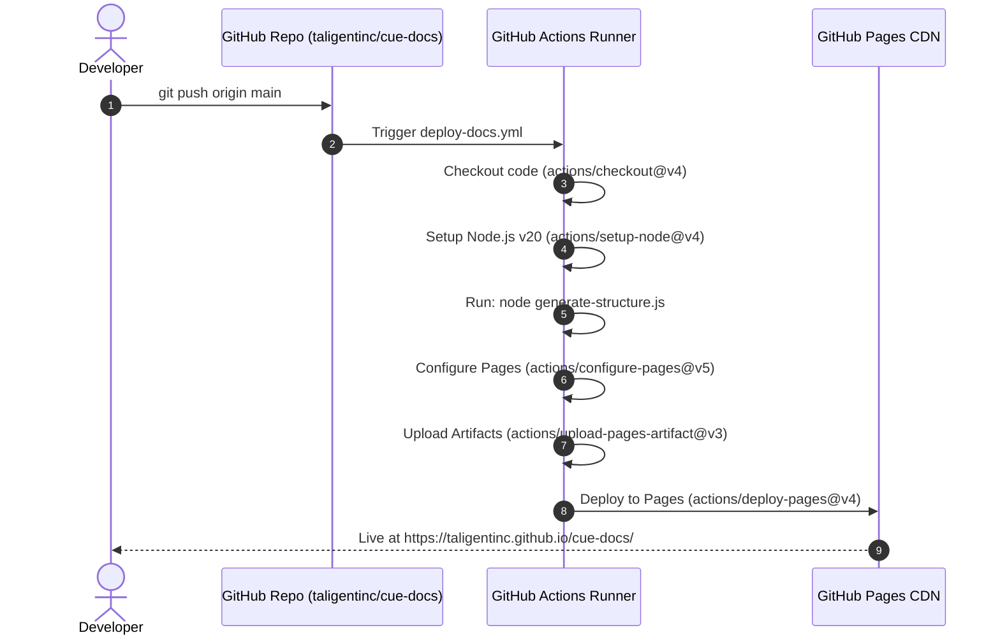

# GitHub Pages Deployment

The Cue Central Documentation Hub is designed for zero-maintenance hosting on **GitHub Pages**, utilizing automated GitHub Actions to index and deploy changes seamlessly.

---

## 🚀 Continuous Deployment Workflow

Every push to the `main` branch triggers the automated deployment pipeline defined in `.github/workflows/deploy-docs.yml`:



### GitHub Actions Workflow:
```yaml
name: Deploy Cue Central Docs to GitHub Pages

on:
  push:
    branches:
      - main
  workflow_dispatch:

permissions:
  contents: write
  pages: write
  id-token: write

concurrency:
  group: "pages"
  cancel-in-progress: false

jobs:
  build-and-deploy:
    environment:
      name: github-pages
      url: ${{ steps.deployment.outputs.page_url }}
    runs-on: ubuntu-latest
    steps:
      - name: Checkout Repository
        uses: actions/checkout@v4

      - name: Setup Node.js
        uses: actions/setup-node@v4
        with:
          node-version: 20

      - name: Generate Folder Structure Index
        run: |
          node generate-structure.js

      - name: Setup GitHub Pages
        uses: actions/configure-pages@v5

      - name: Upload Pages Artifact
        uses: actions/upload-pages-artifact@v3
        with:
          path: '.'

      - name: Deploy to GitHub Pages
        id: deployment
        uses: actions/deploy-pages@v4
```

---

## 🌐 Custom Domains & DNS Setup

To serve the documentation hub from a custom domain (e.g., `docs.cue.corp.lbcgj.com` or `docs.cuecentral.org`):

1. Create a `CNAME` file in the repository root containing your custom domain:
   ```text
   docs.cuecentral.org
   ```
2. In your DNS provider (e.g. Cloudflare, Route53, Google Domains), add a `CNAME` record:
   * **Host / Name**: `docs`
   * **Target / Value**: `dspillmangj.github.io.`
3. In GitHub Repository Settings under **Pages**, enable **Enforce HTTPS**.
