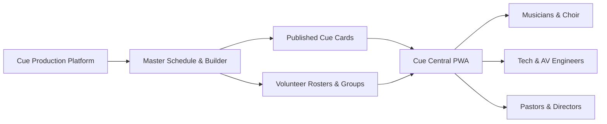

# Platform Overview

**Cue Central** is a specialized worship production and ministry portal designed to eliminate the friction of coordinating live church services. It brings together music directors, pastors, audio/visual engineers, accompanists, choir members, and special music soloists into a synchronized real-time interface.

---

## 🎯 Core Capabilities

Cue Central replaces fragmented emails, printed paper cue cards, and disparate spreadsheets with a unified ecosystem:

### 1. Live Interactive Cue Cards
Every Sunday morning, Sunday evening, and Wednesday midweek service features a dynamic **Cue Card**. Volunteers and operators can open the Cue Card on their phone, iPad, or laptop to view:
* Exact service item sequence (Openers, Hymns, Announcements, Specials, Sermon, Invitation).
* Planned duration, elapsed runtime, and remaining service countdowns.
* Real-time service progression and status highlights.
* Supplemental performance notes, keys, and accompanist tags.

### 2. Volunteer Scheduling & "My Assignments"
Team members no longer need to search through multi-page PDF rosters. Cue Central automatically identifies the logged-in user via **Authentik SSO** and presents their upcoming 30-day assignment list:
* Specific service dates, times, and roles (e.g. *Choir Opener*, *Pianist*, *Offertory Special*).
* Associated song titles and arrangement details.
* Direct one-click access to the digital sheet music for their assigned songs.

### 3. Digital Sheet Music & Repertoire Library
Musicians can access choral arrangements, hymn scores, and special music pieces directly inside the app:
* Complete searchable archive of sheet music PDFs.
* Streaming rehearsal audio tracks and YouTube reference recordings.
* Historical usage logs to ensure songs are rotated appropriately without repetitive overlap.

### 4. Availability & Blackout Management
Volunteers can submit **Days Off** and vacation dates directly through the portal:
* Date range selections with granular options (Morning service, Evening service, or All Day).
* Director alerts when building monthly schedules to prevent double-booking unavailable personnel.

### 5. Progressive Web App (PWA) with Offline Access
Cue Central functions as an installable app across all operating systems:
* Add to Home Screen on iPhone, iPad, Android, macOS, and Windows.
* Fast offline caching for rehearsal orders and cached sheet music.
* Ambient dark and light modes tailored for dim sanctuary lighting or bright daytime practice.

---

## 🏛️ Ecosystem Architecture

| Component | Responsibility | Hostname / Service |
| :--- | :--- | :--- |
| **Cue Central** | Volunteer & musician portal, assignments, mobile cue viewer, sheet music | `cue.corp.lbcgj.com/central_*` |
| **Cue Builder** | Director console for building service flow, drag-and-drop order, schedule publishing | `cue.corp.lbcgj.com/builder.php` |
| **Authentik SSO** | Forward authentication proxy, identity management, MFA, group permissions | `outpost.goauthentik.io` |
| **Documentation** | Static SPA documentation hub hosted on GitHub Pages | `taligentinc.github.io/cue-docs` |

---

## 🚀 Next Steps

* Follow the [Volunteer & Musician Quickstart](quickstart.md) to log in and tour your dashboard.
* Learn how to [Install the PWA on iOS & Android](pwa-install.md).
* Review [Roles & Access Permissions](roles-and-permissions.md) for ministry teams.
