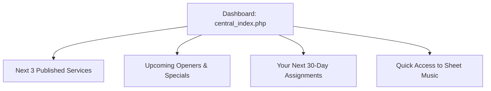

# Volunteer & Musician Quickstart

Get up and running with Cue Central in under 5 minutes. This guide walks you through logging in with Authentik SSO, reviewing your dashboard, accessing your upcoming assignments, and opening your first digital Cue Card.

---

## 1. Sign In to Cue Central

1. Navigate to your church's Cue Central portal at [cue.corp.lbcgj.com](https://cue.corp.lbcgj.com).
2. If prompted, sign in via **Authentik SSO** using your authorized church email address and password.
3. If Multi-Factor Authentication (MFA) is enabled on your account, enter your TOTP security code.
4. Once authenticated, the proxy forwards your identity headers (`X-Authentik-Email`, `X-Authentik-Username`) and opens your **Cue Central Dashboard**.

> [!NOTE]
> If you see an **Access Denied** screen, your account needs to be added to the `n-cue-central` permission group in Authentik by your ministry administrator. Contact your worship director to confirm your roster profile.

---

## 2. Navigating the Volunteer Dashboard

Your home dashboard provides an immediate high-level summary of upcoming worship services:

* **Upcoming Services Card**: Displays the next 3 published services (date, service type, and start time).
* **Openers & Specials**: Displays the selected choral openers and vocal specials for the immediate upcoming service.
* **My Upcoming Assignments**: A personalized list of dates and times where your name or ensemble group is scheduled to minister.
* **Direct Links**: Quick jump buttons to download sheet music, review the master calendar, or launch the live Cue Card.

---

## 3. Check Your Schedule & Call Times

1. In the top navigation bar (or mobile menu), click **My Assignments** (`central_myschedule.php`).
2. Review your personal assignment timeline:
   * **Service Date & Time**: Sunday Morning (10:30 AM), Sunday Evening (6:00 PM), or Wednesday (7:00 PM).
   * **Assigned Role**: Choir Section, Pianist, Offertory, Special Music, or Tech Crew.
   * **Song Selection**: The specific title and arrangement scheduled.
3. Click any song title with a document icon to instantly open the attached PDF in the **Sheet Music Viewer**.

---

## 4. Open an Interactive Cue Card

1. Click **Cue Cards** in the top navigation bar (`central_cuecards.php`).
2. Select an upcoming service card (e.g. *Sunday Morning Worship - 10:30 AM*).
3. The interactive **Cue Card Viewer** opens:
   * View the complete order of service from opening prelude to closing benediction.
   * Track the current item being ministered on stage.
   * Review notes regarding keys, modulating interludes, or microphone assignments.

---

## 5. Submit Your Blackout Dates / Days Off

If you know you will be out of town or unavailable for an upcoming service:

1. Open **My Assignments** (`central_myschedule.php`).
2. Scroll to the **Request Days Off / Availability** section.
3. Select your **Start Date** and optional **End Date** (for multi-day vacations).
4. Choose the time frame:
   * **All Day** — Unavailable for all services on that date.
   * **Morning Only** — Available for evening/midweek, but out for morning service.
   * **Evening Only** — Available for morning, but out for evening service.
5. Click **Submit Day Off** to record your unavailability in the master director database.

---

## 6. Install the App on Your Phone or Tablet

For the fastest Sunday morning experience, install Cue Central as a standalone Progressive Web App (PWA). Follow our simple [PWA Installation Guide](pwa-install.md) for step-by-step instructions for iPhone, iPad, Android, and desktop devices.
