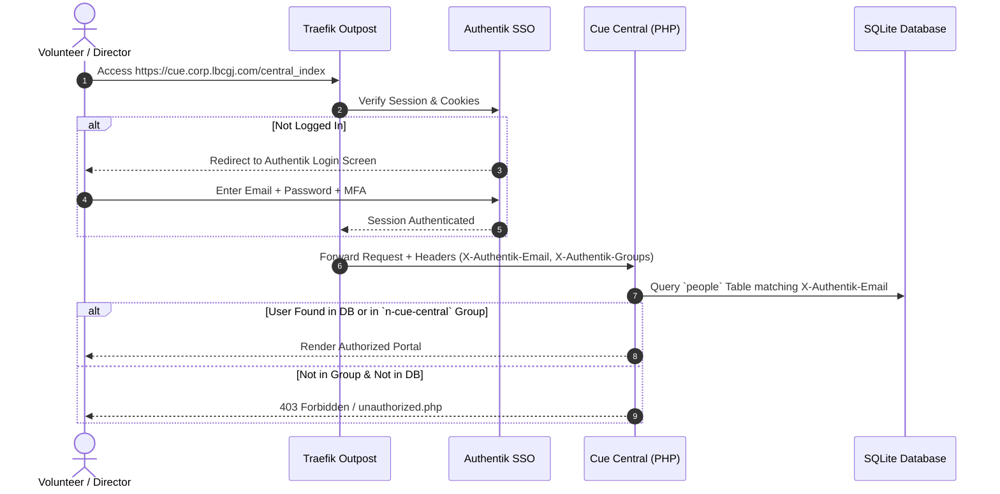

# Roles & Access Permissions

Cue Central uses enterprise-grade **Forward Authentication** powered by [Authentik](https://goauthentik.io) integrated behind a reverse proxy (Traefik). This ensures robust identity verification, Single Sign-On (SSO), and role-based access control (RBAC).

---

## 🔐 How Authentication Works

When a request arrives at `cue.corp.lbcgj.com`:



### Forwarded Security Headers:
* `HTTP_X_AUTHENTIK_EMAIL`: The authenticated email address of the user (e.g. `sarah.smith@lbcgj.com`).
* `HTTP_X_AUTHENTIK_USERNAME`: The system username in Authentik.
* `HTTP_X_AUTHENTIK_GROUPS`: Pipe-delimited list of Authentik security groups (e.g. `n-cue-central|worship-directors`).
* `HTTP_X_AUTHENTIK_NAME`: Full display name resolved from Authentik profile or cached locally in `user_name_cache`.

---

## 👥 Permission Tiers

| Tier | Role | Authentik Group | Capabilities |
| :--- | :--- | :--- | :--- |
| **Tier 1** | **Volunteer / Musician** | `n-cue-central` | View personalized assignments, view published Cue Cards, access sheet music library, submit days off & blackout ranges. |
| **Tier 2** | **Music Director / Worship Leader** | `cue-directors` | Full Cue Builder access (`builder.php`), drag-and-drop service ordering, assign specials/openers, publish monthly schedules and cue cards. |
| **Tier 3** | **Production & Tech Crew** | `cue-production` | Live fullscreen cue card runner, AV timing tracking, audio/visual item triggers, setlist exports. |
| **Tier 4** | **Super Administrator** | `cue-superadmins` | Database migrations, table initialization (`init.php`, `install.php`), group creation, S3 asset synchronization, and Authentik outpost configuration. |

---

## ⚙️ Authorization Enforcement Code

Every page in Cue Central verifies authorization at the very top of script execution:

```php
<?php
$currentPage = "central_index";
require "db.php";

$authEmail = $_SERVER["HTTP_X_AUTHENTIK_EMAIL"] ?? "";
$authGroupsRaw = $_SERVER["HTTP_X_AUTHENTIK_GROUPS"] ?? "";
$authGroups = array_map("trim", explode("|", $authGroupsRaw));

$isPerson = false;
$personId = null;

// Check 1: Authentik Group Membership
if (in_array("n-cue-central", $authGroups)) {
    $isPerson = true;
}

// Check 2: Registered People Record in Database
if ($authEmail) {
    $stmt = $db->prepare("SELECT id FROM people WHERE email = ?");
    $stmt->execute([$authEmail]);
    $personId = $stmt->fetchColumn();
    if ($personId) {
        $isPerson = true;
    }
}

// If neither condition is met, abort immediately
if (!$isPerson) {
    $unauthType = "smc";
    require "unauthorized.php";
    exit;
}
?>
```

---

## 🛡️ Best Practices for Administrators

1. **Keep Emails Consistent**: Ensure the volunteer's email address in the `people` table matches their primary login in Authentik.
2. **Assign `n-cue-central` Group**: Place all choir members, vocalists, accompanists, and AV volunteers in the `n-cue-central` group.
3. **Revocation**: Removing a user from the Authentik group or clearing their record from `people` immediately revokes their portal access across all active sessions.
