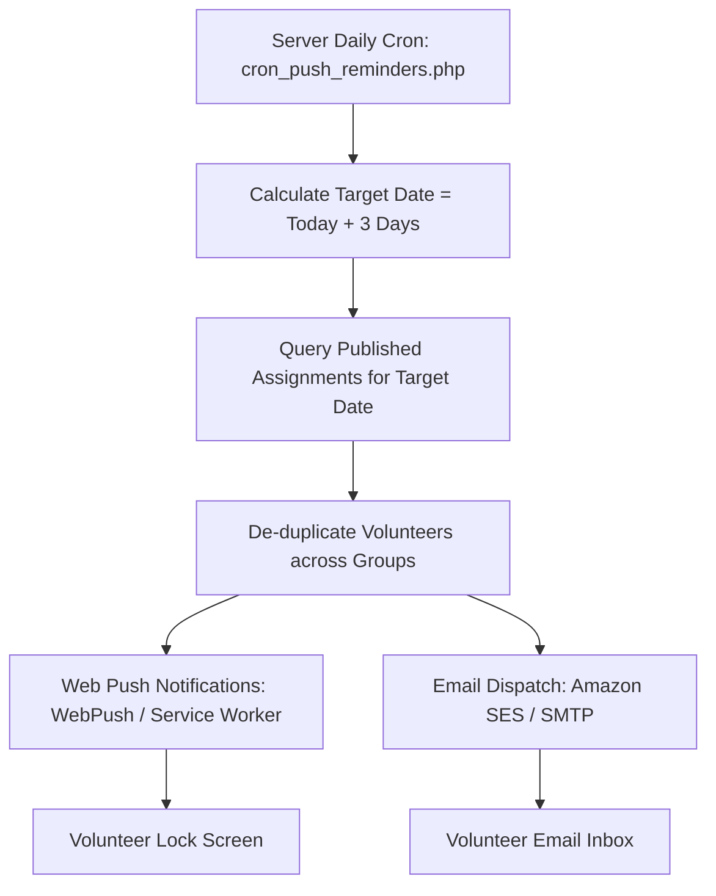

# Automated Push & Email Reminders

Cue Central features an automated notification pipeline that ensures volunteers and musicians never miss an upcoming call time or special music presentation.

---

## ⏰ Notification Cadence

Automated reminders are dispatched daily via cron jobs configured on the production host server:

* **Timing**: Exactly **3 days prior** to the scheduled service date (e.g. Thursday morning for Sunday services).
* **Target Audience**: Every member assigned to an active, published service role or ensemble piece.
* **De-duplication**: If a musician is singing in the choir AND playing an offertory special on the same service date, Cue Central combines these into a single consolidated notification instead of spamming multiple alerts.

---

## 🔔 Web Push Notification Setup

Volunteers with Cue Central installed on their phones or tablets can enable real-time push alerts:

1. When logging in for the first time, tap **Enable Push Notifications** when prompted by your browser or PWA.
2. If prompted by iOS or Android, tap **Allow**.
3. Cue Central registers your device's unique push subscription endpoint in the database via `PushNotificationService.php`.
4. Notifications appear natively on your lock screen with one-tap navigation directly to your service Cue Card.

---

## 📧 Email Notifications

For volunteers who prefer traditional email reminders:
* Reminder emails include the service date, call time, song title, and a direct link to the [My Assignments](my-assignments.md) page.
* Tracking: Dispatched emails update `services.last_emailed` to prevent duplicate mail delivery.
