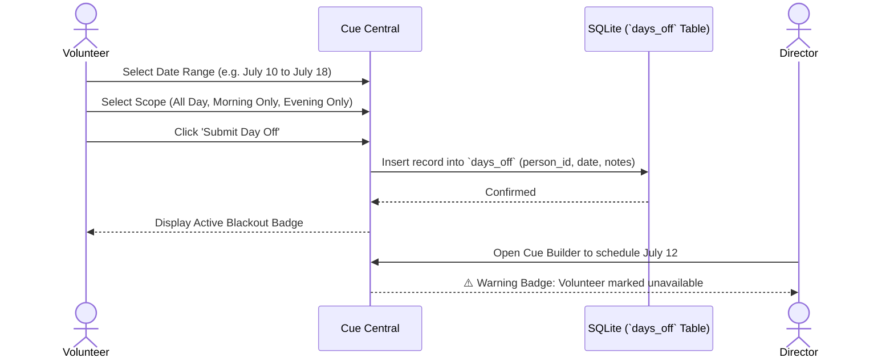

# Blackout Dates & Days Off

To prevent directors from scheduling volunteers during vacations, business trips, or personal conflicts, Cue Central includes a built-in **Days Off / Availability** engine.

---

## 🏖️ Submitting an Unavailability Request

Volunteers can submit blackout dates directly from **My Assignments** (`central_myschedule.php`):

### Form Fields:
1. **Start Date**: The first date of your unavailability.
2. **End Date** *(Optional)*: If submitting a multi-day vacation, specify the ending date. Cue Central automatically generates daily blackout records for every day in the range.
3. **Time of Day Scope**:
   * **All Day**: You are unavailable for both morning and evening services.
   * **Morning Only**: Available for evening service, but absent for morning sound check and service.
   * **Evening Only**: Available for morning service, but absent for evening service.

---

## 🗑️ Managing & Removing Days Off

If your travel plans change or you become available again:

1. Scroll to the **My Requested Days Off** section on **My Assignments**.
2. Locate the date range entry.
3. Click the red **Remove / Cancel** button (`action=remove_day_off_range`).
4. Cue Central purges the records from the database, instantly notifying the scheduling system that you are available for assignments.

---

## 🛡️ Director Conflict Warning Matrix

When directors build schedules in the **Cue Builder**:
* If a director attempts to assign a person or an ensemble whose member has logged a conflict in `days_off`, a prominent amber warning indicator appears.
* This prevents awkward last-minute scramble calls on Sunday mornings.
