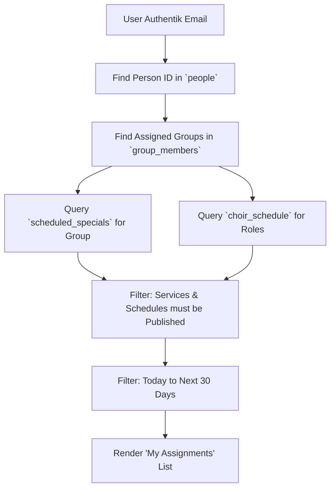

# My Assignments

The **My Assignments** page (`central_myschedule.php`) is the personal command center for every church musician, vocalist, accompanist, and production volunteer. It eliminates confusion by presenting an individualized schedule tailored specifically to you.

---

## 🔍 How Cue Central Identifies Your Assignments

When you load **My Assignments**, Cue Central executes a multi-table discovery query:

1. It matches your verified email against the `people` table.
2. It resolves all group memberships in `group_members` (e.g. *Soprano Section*, *Sanctuary Orchestra*, *Praise Trio*, *AV Sound Booth*).
3. It checks for scheduled special music in `scheduled_specials`.
4. It cross-checks the master role matrix in `choir_schedule`.
5. It filters out unapproved drafts — you only see assignments for services or monthly schedules that the directors have officially marked as **Published**.

---

## 📅 What You See in Your Assignment Card

For each scheduled date:

* **Date & Service**: Formatted clearly (e.g. *Sunday, Dec 6, 2026 - Sunday Morning Worship*).
* **Call Time**: Rehearsal sound-check time (typically 45–60 minutes prior to service).
* **Assigned Role**:
  * *Special Music Soloist / Ensemble*
  * *Choir Opener*
  * *Pianist / Keyboardist*
  * *Offertory Instrumentalist*
  * *AV Audio Engineer / Lighting Operator*
* **Song Title & Repertoire Link**: If a specific song is scheduled, a direct link appears. Clicking it launches the PDF sheet music and rehearsal track.

---

## 🖨️ Exporting & Syncing

* **Save to Calendar**: Add scheduled dates to your personal Apple Calendar or Google Calendar.
* **Printable Assignment Sheet**: Print a monthly list to post on your refrigerator or music binder.
