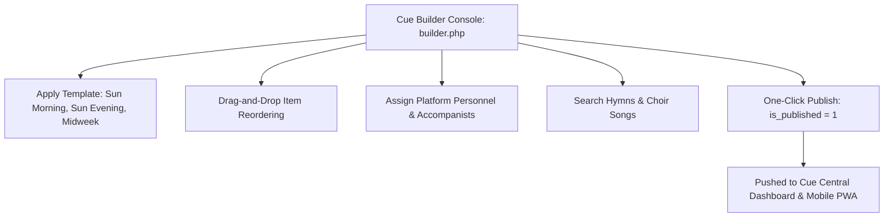

# Cue Service Builder

The **Cue Builder** (`builder.php`) is the command console for music directors, worship leaders, and pastors to construct, sequence, and publish worship services.

---

## 🛠️ Service Builder Interface

### Key Workflow Steps:

1. **Create or Select a Service**:
   * Choose service date, type, and start time.
2. **Apply a Reusable Template**:
   * Instead of typing orders from scratch each week, select a predefined template (`templates` and `template_items`) to instantly populate standard elements.
3. **Insert & Sequence Items**:
   * Drag items up or down to adjust service progression.
   * Search hymns or choir anthems by typing just a few letters.
4. **Assign Personnel**:
   * Designate the morning pianist, offertory player, and special music ensemble.
   * The builder automatically checks `days_off` and warns if an assigned volunteer has recorded a conflict.
5. **Publish to Cue Central**:
   * Toggle **Publish Service** (`is_published = 1`). The service becomes immediately accessible to all choir members and technicians.

---

## 🎨 Color Coding & Badges

Directors can customize visual cues in the builder to give the production team instant visual recognition:
* Background color overrides.
* Border highlights for high-priority transitions.
* Custom font color accents for solo cues.
