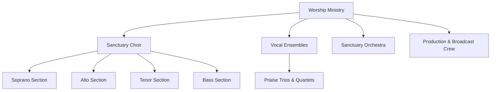

# Groups, Rosters & Ensembles

Cue Central structures personnel into **Groups** (`groups.php`), making it effortless to manage choir sections, instrumental ensembles, praise teams, and tech crews.

---

## 👥 Group Hierarchy & Classifications

### Database Representation:
* `groups`:
  * `name`: Group title (e.g. *Sanctuary Choir*, *Ladies Ensemble*, *Brass Section*).
  * `group_type`: Category identifier (*Choir*, *Ensemble*, *Orchestra*, *Technical*).
  * `classification`: Secondary role categorization.
* `group_members`:
  * Maps `person_id` from `people` to `group_id`.
  * `is_pianist`: Boolean flag indicating if this member can accompany the group.

---

## 📬 Email Lists & Communications

Directors can generate targeted email distribution lists in `email_lists` and `email_list_members`:
* One-click copy of email addresses for specific vocal sections.
* Automated rehearsal change alerts dispatched to all members of an assigned group.
