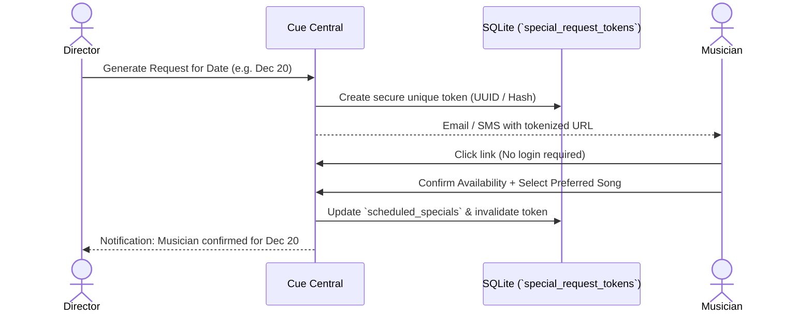

# Special Music Requests & Tokens

To coordinate vocal solos, duets, trios, and family ensembles without endless phone tag, Cue Central utilizes a secure, tokenized **Special Music Request System**.

---

## 🎟️ Tokenized Request Workflows

1. **Director Generation**: In `specials.php`, the director selects a service date and targeted musician or ensemble.
2. **Secure Token**: Cue Central generates a unique, non-guessable token stored in `special_request_tokens`.
3. **Volunteer Confirmation**: The musician opens the link on their mobile device without having to remember credentials. They confirm availability and choose their musical arrangement.
4. **Automatic Scheduling**: Upon submission, the piece is automatically inserted into `scheduled_specials` and queued for the director's final service order.

---

## ⚖️ Service Capacity Limits

To ensure services do not run overtime, the system enforces limits defined in `service_capacities`:
* **Sunday Morning**: Typically limited to 1 featured special.
* **Sunday Evening**: Typically configured for up to 2 specials.
* If a director attempts to schedule beyond the limit, Cue Central displays a capacity advisory.
