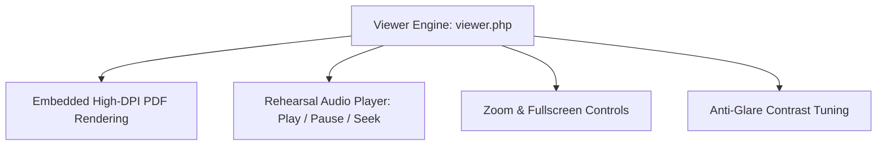

# In-App PDF Viewer & Audio

Cue Central includes an embedded digital **Sheet Music & Media Viewer** (`viewer.php`) tailored for music stands, tablet users, and vocalists practicing at home.

---

## 📄 Digital Sheet Music Viewer

### Key Capabilities:
* **Pinch-to-Zoom & Dual Page Mode**: Smooth scaling on tablets and laptops. Dual-page view allows pianists and organists to view facing pages simultaneously.
* **Low Latency Loading**: Sheet music files hosted securely on Cloudflare or AWS S3 are buffered for instant page turns.
* **Anti-Glare Display**: Optimized background styling minimizes glare under sanctuary stage spotlights.

---

## 🎧 Rehearsal Audio Player

Practice tracks accompany sheet music files whenever available:

* **In-Page Audio Control**: An integrated audio transport bar sits at the top or bottom of the sheet music view.
* **Scrub & Repeat**: Quickly scrub through complex bridges, modulations, or vocal codas.
* **Background Playback**: Audio continues playing as you navigate between stanzas or review rehearsal notes.

> [!TIP]
> **iOS Safari Tip**: Ensure your device is not in silent mode and that you tap the initial play button to allow web audio playback through iOS Safari.
